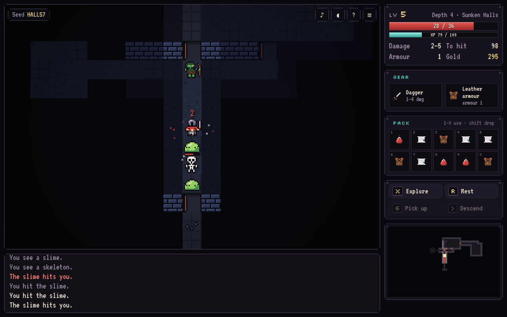
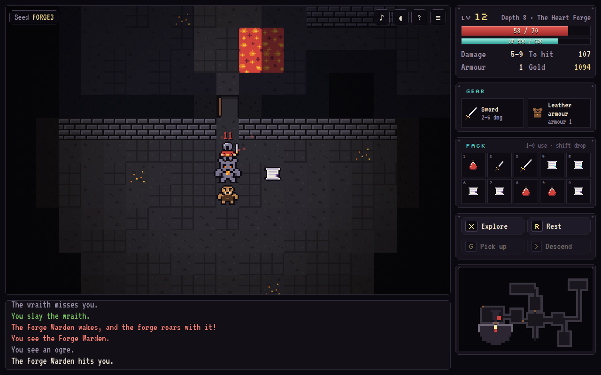

<h1 align="center">Forge Depths</h1>

<p align="center">
  <b>A pixel roguelike in your browser.</b><br>
  Eight procedurally generated depths, field of view and monsters that hunt you down with A*. At the bottom,
  the Forge Warden guards the Ember Heart. Every run is seeded, so the daily run is the same dungeon for
  everyone, any run can be shared as a link, and every run can be replayed move for move.
</p>

<p align="center">
  
</p>

**Live:** https://ardakalper.github.io/forge-depths/

## The game

- **Eight depths in six places**: the Old Mine, the Glowing Caves, the Sunken Halls, the Bone Crypt, the Ember
  Caves and the Heart Forge. Each place has its own walls, floors and colours.
- **Ten monsters with their own habits.**
  - Rats are just rats.
  - Bats flutter about at random.
  - Goblins run when badly hurt, then come back.
  - Slimes are slow but tough.
  - Goblin archers and fire imps shoot from range and back away when you close in.
  - Ogres hit hard.
  - Wraiths are fast.
  - The Forge Warden calls fire imps out of the coals at half health.
- **Sleeping monsters** can be snuck past. They have a chance to wake each turn you are in sight, and a better
  chance when you are close.
- **Gear and magic.**
  - Four weapons, which trade accuracy for damage.
  - Three armours.
  - Potions of healing, might and vigor.
  - Scrolls of teleport, mapping, fire and slumber.
- **Levels** add health, accuracy and, every third level, damage.
- **Doorways matter.** Nobody moves or attacks diagonally around a corner or through a doorway, so a door is a
  place to fight one monster at a time.
- **Permadeath, but a fair one.** Levels depend only on the seed and the depth, so the same seed always builds
  the same dungeon with the same monsters and items.

## Features

- **Daily run:** one seed per day, the same for everyone.
- **Share a seed or a result.** Any seed opens from a link (`?seed=K7QX2M`, `?daily=2026-10-01`). The result
  copies as a short text with a depth bar:
  ```
  Forge Depths · Daily 2026-10-01
  🟩🟩🟩🟩🟩⬛⬛⬛ Depth 5/8
  Level 7 · 41 kills · 412 gold · 1583 turns · score 1236
  Slain by an ogre.
  ```
- **Replays.** A run is stored as its seed plus the list of moves, and the simulation is deterministic, so
  "Watch replay" plays your last run back at 1×, 4× or 16×.
- **Auto-explore and travel.**
  - `x` walks to the nearest unexplored spot or item.
  - `r` rests until healed.
  - Clicking a tile walks there along the shortest known path.
  - All three stop the moment something shows up.
- **A chiptune soundtrack.** Two songs (the slow "Old Stone" and the driving "Heart Forge") and all the sound
  effects are synthesised by [Chiptune Studio](https://github.com/ardakalper/chiptune-studio)'s engine, running
  in an AudioWorklet. The songs are in its song format, so they open in it.
- **Your own sprites.** Draw 16×16 frames in [Pixel Editor](https://github.com/ardakalper/pixel-editor) (or
  Aseprite), tag each with the sprite it replaces (`hero`, `goblin`, `wall_face`…), and load the exported sheet.
- **Hall of fame**, a run that saves after every move, and a title screen where a bot plays a run behind the
  menu.
- Keyboard (arrows, numpad, vi keys or WASD), mouse, and a d-pad on phones. Works offline as a PWA.
- Plain HTML, CSS and ES modules. No build step, no runtime dependencies.

<p align="center">
  
</p>

## How it works

| Part | How |
| --- | --- |
| Rooms | Rooms placed without overlap and joined by a minimum spanning tree (Prim) of L-shaped corridors. A few extra links make loops, and doors go where corridors meet rooms. |
| Caves | A cellular automaton (4-5 rule) keeps only the largest connected cave. |
| Lava | Each pool is rejected if it would cut any walkable tile off from the rest. |
| Stairs | Placed among the tiles farthest from the start, using breadth-first distances. |
| Field of view | Symmetric shadowcasting with exact fractions: if you can see a monster, it can see you. Monsters use that instead of their own FOV pass to decide when to chase and shoot. |
| Pathfinding | A* with a binary heap and a Chebyshev heuristic. It obeys the same diagonal rule as the player and steers around other monsters. Wandering monsters cache their routes. |
| Auto-explore | A multi-source Dijkstra map from every frontier tile and every item worth picking up, walked downhill. |
| Turns | Energy based: speed 50 slimes act every other turn, speed 150 bats act three times in two turns. |
| Randomness | Seeded mulberry32. The dungeon, the population and the combat rolls each draw from their own stream, so the levels do not depend on how you fight. |
| Balance | A bot that explores, fights, drinks potions and wears the best gear plays hundreds of seeded runs (`npm run balance`). It wins about 14% of them; a careful human who rests and fights in doorways does much better. |

## Run it locally

```sh
git clone https://github.com/ardakalper/forge-depths
cd forge-depths
npm start            # serves app/ on http://localhost:4181
npm run balance      # 300 bot runs: win rate, deepest depth, what killed it
```

## Tests

```sh
npm install
npm run test:unit    # every level of many seeds is connected with far stairs; FOV is symmetric on real maps;
                     # A* finds the shortest path; combat, levels, items, doors, pick-up rules; monster AI
                     # (chase, shoot, flee, sleep, the Warden's summons); auto-explore clears a level;
                     # save/load continues identically; whole bot runs replay to the identical state
npm run test:e2e     # Playwright: title, moving, auto-explore, travel by click, stairs, fighting, the pack,
                     # death screen, sharing, replay, victory, daily run, saves, seed links, music and sound,
                     # custom sprites from a sheet, phone layout and d-pad
```

Set `PW_CHROMIUM_PATH=/path/to/chrome` to reuse an installed Chromium. CI runs both suites on every push and
deploys `app/` to GitHub Pages when `main` is green.

## How it is built

```
app/js/rng.js        seeded generator, string hashing, readable seed codes
app/js/dungeon.js    level generation: rooms and corridors, caves, lava, doors, stairs; movement rules
app/js/fov.js        symmetric shadowcasting
app/js/path.js       A* and Dijkstra maps
app/js/data.js       monsters, items, depth tables, experience levels
app/js/game.js       the rules: turns, combat, monster AI, items, auto-explore, saving, replays
app/js/bot.js        the bot used by the title screen, the balance tool and the tests
app/js/sprites.js    hand-drawn 16×16 sprites and the per-depth colour themes
app/js/render.js     canvas renderer: torchlight, smooth movement, damage numbers, projectiles, minimap
app/js/music.js      the soundtrack and sound effects in Chiptune Studio's format
app/js/audio.js      AudioWorklet playback (app/js/chip/ is Chiptune Studio's engine)
app/js/sheet.js      Aseprite / Pixel Editor sprite-sheet reader
app/js/main.js       title screen, input, sidebar, dialogs, replays, hall of fame
```

## License

MIT. Fonts: Jacquard 12, VT323 and Silkscreen, all under the SIL Open Font License.
